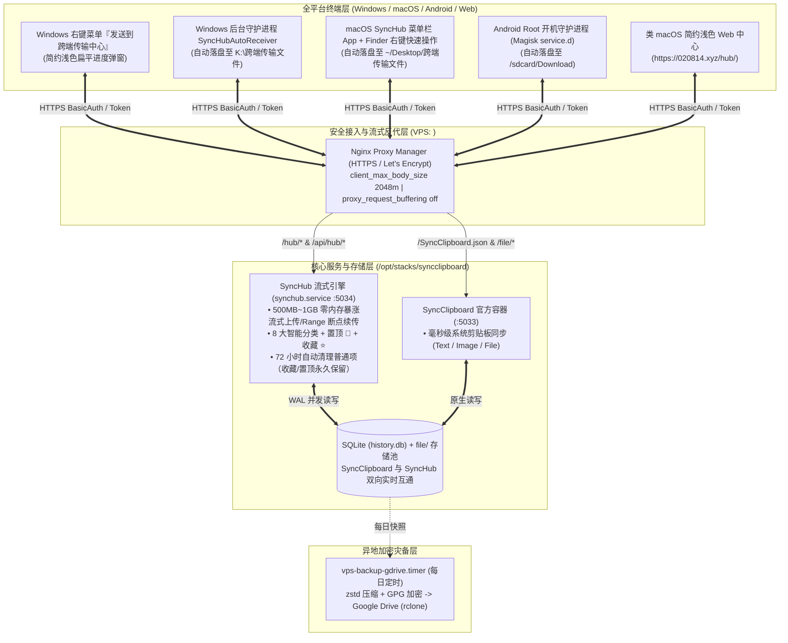

# SyncClipboard + SyncHub 跨平台剪贴板与大文件闪传收藏中心（完整交付包）

> **设计标准**：**类 macOS 简约浅色扁平化** 视觉规范（系统字体、白 / 浅灰中性底色、1px 细分隔线、单一蓝色强调色、Finder 式侧边栏，无毛玻璃 / 渐变 / 发光）  
> **覆盖平台**：Windows 11 / macOS / Android (Root & HTTP Shortcuts) / 全平台 Web 端  
> **线上地址**：`https://020814.xyz/hub/` （Web 闪传与收藏中心） | `https://020814.xyz` （SyncClipboard WebDAV/API 根端点）

---

## 一、 项目全景架构

本系统在原版 **SyncClipboard**（跨平台毫秒级文本/图片/小文件剪贴板同步）的基础上，深度融合并扩展了 **SyncHub 大文件流式闪传与分类收藏中心**，直接共用同一套 SQLite 数据库（`history.db`）与本地文件存储池，彻底解决微信文件传输助手需频繁扫码登录、大文件受限、无自动落盘及缺乏分类归档的痛点。



---

## 二、 核心账号、端点与目录速查表

| 类别 | 参数项 | 生产环境配置值 |
| :--- | :--- | :--- |
| **Web 中心** | 跨端传输与收藏中心 (SyncHub UI) | `https://020814.xyz/hub/` |
| **免密直链** | 带 BasicAuth 的一键书签/快捷方式 | `https://用户名:密码@020814.xyz/hub/` |
| **核心服务** | SyncClipboard 客户端连接地址 | `https://020814.xyz` |
| **认证凭据** | 用户名 / 密码 (BasicAuth) | 用户名 / 密码由部署者自行设置（见根目录 `.env.example`），请勿使用弱密码 |
| **消息推送** | ntfy 自建通知中心 | `https://ntfy.020814.xyz` |
| **VPS 主机** | IP / SSH 端口 / 用户 | `<VPS_IP>` / 端口 `22` / 用户 `root` |
| **VPS 路径** | SyncHub 主程序与服务 | `/usr/local/bin/synchub-server.py` (`synchub.service`) |
| **VPS 路径** | SyncClipboard 容器与数据库目录 | `/opt/stacks/syncclipboard/data/server/` (`history.db`) |
| **Windows** | 自动接收落盘目录（含桌面快捷方式） | `K:\跨端传输文件` |
| **Windows** | 客户端与右键脚本安装目录 | `C:\Program Files\SyncClipboard\synchub_client.py` |
| **Windows** | Glass Folders 桌面收纳卡片入口 | 桌面『系统工具』毛玻璃文件夹 -> `跨端传输与收藏中心` / `跨端传输目录` |
| **macOS** | 自动接收落盘目录 | `~/Desktop/跨端传输文件` |
| **macOS** | 菜单栏 App | `~/Applications/SyncHub.app`（设置：服务器 / 账号存钥匙串 / 接收目录 / 登录启动） |
| **Android** | 手机端自动接收落盘目录 | `/sdcard/Download`（系统“下载”文件夹） |

---

## 三、 交付包目录结构说明

```text
SyncClipboard_SyncHub_完整交付包/
├── 00_交付说明与使用手册/
│   ├── README.md                          # 本文件：项目总览、架构图、核心参数与目录索引
│   ├── DEPLOYMENT_AND_OPS_GUIDE.md        # 服务端部署、Nginx 流式反代、Docker 与异地加密备份运维手册
│   └── USER_MANUAL.md                     # Windows / macOS / Android / Web 四端日常操作与快捷键指南
├── 01_服务端_SyncClipboard与SyncHub/
│   ├── synchub_server.py                  # SyncHub 核心流式服务端 + 类 macOS 简约浅色扁平前端单文件源码
│   ├── synchub.service                    # systemd 守护进程配置文件 (/etc/systemd/system/synchub.service)
│   ├── docker-compose.syncclipboard.yml   # SyncClipboard 官方容器编排文件
│   ├── docker-compose.ntfy.yml            # ntfy 跨端消息推送容器编排文件
│   ├── nginx_020814.xyz.conf              # Nginx Proxy Manager 生产级反代配置（支持 2GB 流式直传）
│   ├── vps-backup-gdrive.sh               # Google Drive 异地加密自动备份脚本
│   ├── vps-backup-gdrive.service          # 备份 systemd 服务单元
│   └── vps-backup-gdrive.timer            # 备份 systemd 每日定时器单元
├── 02_Windows客户端与右键套件/
│   ├── synchub_client.py                  # Windows 右键简约浅色上传进度窗 + 后台自动接收守护进程
│   ├── 一键安装_Windows右键与自动接收.bat   # 双击自动注册资源管理器右键菜单与后台静默接收服务
│   ├── SyncClipboard.json                 # 当前已调优的 Windows SyncClipboard 客户端配置文件
│   └── SyncClipboard.json.example         # 脱敏版客户端配置模板
├── 03_macOS自动接收与Finder右键套件/
│   ├── install_mac_synchub.sh             # macOS 一键安装：编译 SyncHub 菜单栏 App + Finder 右键（失败时自动改用简易模式）
│   ├── uninstall_mac_synchub.sh           # macOS 卸载脚本
│   ├── README_zh.md                       # Mac 端安装与使用说明
│   └── SyncHubMac/                        # 菜单栏 App 源码（Swift / SwiftUI，用 Xcode 命令行工具编译）
├── 04_Android_Root自动落盘套件/
│   └── install_android_root_synchub.sh    # Android Root (Magisk) 开机自启自动下载至 /sdcard/Download 安装脚本
└── 05_自动化部署与验收测试脚本/
    ├── deploy_synchub_to_vps.py           # 一键通过 SFTP 热更新 synchub_server.py 至 VPS 并重启验证
    ├── verify_all_endpoints.py            # 全链路健康检查脚本（API、Web UI、大文件流式接口、分类与过期策略）
    ├── m2_verify_sync.py                  # 跨平台剪贴板同步协议与历史记录专项测试脚本
    └── m4_verify_backup.py                # Google Drive 加密备份与恢复演练验证脚本
```
