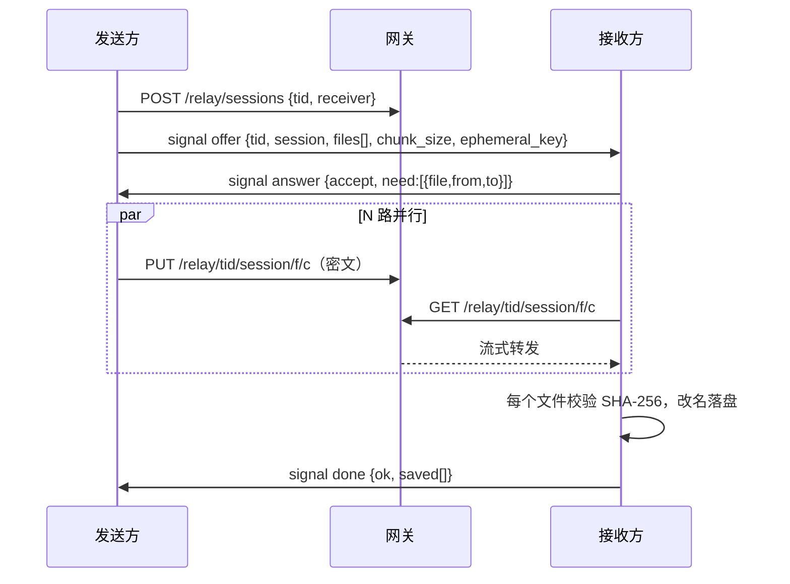

# SyncHub 传输协议 v1（网关 + 多中继 + 局域网直连）

> 适用于 `server/gateway`（Go 网关）及所有客户端（Flutter 三端、`hubctl` 参考实现）。
> 参考实现：[`internal/client`](../server/gateway/internal/client)，权威类型定义：[`internal/proto/proto.go`](../server/gateway/internal/proto/proto.go)。

## 1. 角色与路由

| 组件 | 职责 |
|---|---|
| **gateway**（新，`:5040`，Nginx 路径 `/gw/`） | 设备注册与吊销、配对码、在线状态（WebSocket）、信令转发、流式中继、ICE 配置 |
| **synchub_server.py**（保留） | 云端收藏 / 离线投递；新增：接受网关签发的设备令牌 |
| **SyncClipboard**（保留） | 剪贴板同步，协议不变 |

选路顺序：`lan`（已实现）→ `webrtc`（P2）→ `relay`（已实现，多节点择优）→ 对方离线时走 SyncHub 云端（P2）。

## 2. 认证

- **账号**：沿用 `SYNCHUB_USER` / `SYNCHUB_PASSWORD`，**只用于注册新设备**。
- **设备令牌**：`shd_…`，注册时返回一次，服务端只保存 SHA‑256。之后所有接口都用 `Authorization: Bearer <token>`（浏览器的 WebSocket 可以用 `?token=`）。
- **配对码**：已登录的设备调用 `POST /api/v1/pairing-codes` 得到 6 位码（5 分钟有效、只能用一次），新设备用 `X-Pairing-Code` 头注册，**不需要知道账号密码**。
- **防爆破**：同一 IP 10 分钟内失败 10 次就返回 429。
- **吊销**：`DELETE /api/v1/devices/{id}`，被吊销设备的 WebSocket 会立即断开。

## 3. REST 接口

| 方法  | 路径 | 认证 | 说明 |
|---|---|---|---|
| GET | `/healthz` | — | 健康检查 |
| POST | `/api/v1/devices/register` | Basic 账号 或 `X-Pairing-Code` | 请求体 `{name, platform, public_key}` → 返回 `{device_id, token}` |
| GET | `/api/v1/devices` | Bearer | 返回 `{self, devices:[DeviceInfo]}` |
| PATCH | `/api/v1/devices/me` | Bearer | 请求体 `{name}`，重命名本机 |
| DELETE | `/api/v1/devices/{id}` | Bearer | 吊销设备 |
| POST | `/api/v1/pairing-codes` | Bearer | 返回 `{code, expires_at}` |
| GET | `/api/v1/auth/introspect` | Bearer | 返回 `{device_id, name, platform}`，供 synchub_server.py 校验令牌 |
| GET | `/api/v1/ice` | Bearer | 返回 `{ice_servers:[…]}`；TURN 凭据采用 coturn REST 格式（HMAC‑SHA1，12 小时有效） |
| GET | `/api/v1/ws` | Bearer | WebSocket：在线状态 + 信令 |
| POST | `/api/v1/relay/sessions` | Bearer（发送方） | 请求体 `{transfer_id, receiver}` → 返回 `{relays:[RelayInfo], ticket}`（发送方票据） |
| POST | `/api/v1/relay/tickets` | Bearer（接收方） | 请求体 `{transfer_id}` → 返回同一份中继列表和接收方票据 |
| PUT | `<relay>/api/v1/relay/{tid}/{session}/{file}/{chunk}` | `Authorization: Ticket <t>`（角色 s） | 请求体为一个加密分块，必须带 `Content-Length`（≤ 16 MiB + 16） |
| GET | `<relay>/api/v1/relay/{tid}/{session}/{file}/{chunk}` | `Authorization: Ticket <t>`（角色 r） | 返回同一个分块 |

### 多中继节点与票据

- `RelayInfo = {id, url, cert_sha256?, region?}`：`url` 为空表示网关自身（即客户端配置的网关地址）。`cert_sha256` 不为空时，该节点使用自签证书，客户端**只接受指纹完全一致的证书**；指纹由网关通过可信的 HTTPS 下发，因此不需要域名。
- 票据格式为 `b64url(json{t: tid, d: device, r: "s"|"r", e: 过期时间}) "." b64url(HMAC-SHA256(relay_secret, payload))`，有效期 24 小时。中继节点无状态、不连数据库，只用共享的 `GATEWAY_RELAY_SECRET` 验证票据。
- **选路**：发送方对所有节点各请求两次 `/healthz`，取第二次（连接已建立后）的往返时间，选最快的节点，把它的 `id` 写进 offer 的 `relay` 字段，接收方使用同一个节点。某个节点在本次传输中失败后，2 分钟内不再选它，改用下一个。
- **当前部署**：中继节点 `la` 与兜底节点 `main` 的地址由部署环境变量提供，不写死在协议实现里。

### 中继语义

同一个 `{tid}/{session}/{file}/{chunk}` 的 PUT 和 GET 在网关处**会合**：先到的一方最多等待 30 秒，然后网关把 PUT 的请求体直接 `io.Copy` 到 GET 的响应里。**网关不落盘、不缓存整块**。路径里带上 `session`，是为了保证上一轮被中止时留在网关的 PUT 不会交给新一轮的 GET（新一轮用的是新密钥，旧数据会解密失败）。

| 状态码 | 含义 | 客户端处理 |
|---|---|---|
| 204（PUT）/ 200（GET） | 成功 | — |
| 504 | 对端还没到 | 立即重试，最多 8 次 |
| 409 | 同一个分块已经有一个接收者在等 | — |
| 403 | 不是这次会话的参与方（或网关重启后会话丢失） | 结束本轮，重新发 offer |
| 502 | 流中断 | 退避后重试 |

## 4. WebSocket 帧

```json
{"type":"signal","id":"x1","to":"dev_…","payload":{…}}   // 客户端 → 网关
{"type":"signal","from":"dev_…","payload":{…}}           // 网关 → 客户端（from 由网关填写，不可伪造）
{"type":"devices","payload":[DeviceInfo…]}               // 连接时及设备增删改时下发
{"type":"presence","payload":{"device_id":"…","online":true}}
{"type":"error","id":"x1","payload":{"code":"offline|unknown_device|bad_request"}}
{"type":"ping","id":"…"} → {"type":"pong","id":"…"}
{"type":"hello","payload":{"lan":["http://192.168.1.5:53318"]}}  // 客户端 → 网关：上报本机局域网地址
```

网关每 25 秒发一次 WS ping。客户端断线后按 1→2→4…→30 秒退避重连。`DeviceInfo.lan` 只在设备在线时出现，内容是它自己上报的局域网地址。

### 局域网直连（`route = "lan"`，P1 已实现）

- 接收方在 `:53318` 上开一个 HTTP 端点（端口被占用时改用随机端口），并通过 `hello` 上报 `http://<私网IPv4>:<端口>`：
  - `GET /synchub/v1/ping` 返回 `{"device_id": …}`
  - `PUT /synchub/v1/chunk/{tid}/{session}/{file}/{chunk}`（请求体为加密分块）返回 204
- 发送方在发 offer 之前并发探测目标设备的所有局域网地址（超时 1.5 秒，并核对 `device_id`）。有一个能通，就在 offer 里写 `route: "lan"`，直接把分块 PUT 过去，不经过任何服务器；都不通就走中继。
- 局域网这一段**不需要额外鉴权**：分块用会话密钥做了 AEAD 加密，别人伪造的分块会被拒收（400），而且不会打断正在进行的传输。
- 局域网传输中途失败时，发送方把 `lan` 标为 2 分钟内不可用，下一轮自动改走中继，并从断点继续。

## 5. 传输会话（端到端，网关不解析）



- **Offer**：`transfer_id`（发送方生成并持久化，续传期间不变）+ `session`（每轮随机）+ 文件清单。文件清单的每一项包括：相对路径（以 `/` 分隔）、大小、mtime、SHA‑256；空目录单独放在 `dirs` 里。
- **Answer**：接收方把**已收到的分块**从需求中扣掉，用 `need` 返回缺失分块的区间 `[from, to)`。全新传输时 `need` 覆盖全部分块，续传时只包含剩余部分。拒收时回复 `accept=false`，`reason` 为 `declined` 或 `invalid`（发送方会放弃这次传输），或 `busy`（发送方稍后重试）。
- **推送顺序**：双方都按 `need` 的顺序、用相同的并行度取分块，因为网关是按分块会合的，所以不会死锁。
- **Done**：成功时 `ok=true` 并附上保存路径；失败时 `ok=false` 并附原因（如哈希不符、磁盘满），发送方会退避后重新发 offer。
- **Cancel**：任意一方可以发，表示永久取消。接收方会删除已收的部分数据，发送方会删除发件箱中的记录。

### 断点续传

| 一方的情况 | 保存的状态 | 恢复方式 |
|---|---|---|
| 接收方 | `接收目录/.synchub-partial/<tid>/state.json`（每个文件一个分块位图，每 0.5 秒落盘）和 `f<i>.part` | 收到同一个 `tid` 的 offer 且清单摘要一致时，从位图继续；清单变了就丢弃重来 |
| 发送方 | `state/outbox/<tid>.json` | 进程重启、对端重新上线（presence）或网络恢复后自动重新发 offer；在后台使用时用 `.lease` 文件防止两个进程同时发送 |
| 对端掉线 | — | 网关广播 presence 离线，双方立刻中止当前一轮，对端上线后马上重新开始 |
| 源文件改动 | — | 大小或 mtime 变了，传输失败并提示，不会发出拼接错误的文件 |

### 落盘规则（与现有 SyncHub 自动接收一致）

- 路径先清洗：拒绝绝对路径、`..`、盘符、反斜杠；把 Windows 非法字符替换成 `_`；对 `CON`、`NUL` 等保留名加前缀。
- 单个文件：如果目标位置已有大小和 SHA‑256 都相同的文件，就直接跳过；同名但内容不同时另存为 `名称 (1).ext`。
- 文件夹：顶层目录名重复时改为 `目录 (1)`，同一次传输内保持一致；mtime 按原文件还原。

## 6. 端到端加密

```
ikm = X25519(eph_s, R) ‖ X25519(S, R)          # 发送方视角
key = HKDF-SHA256(ikm, salt = tid "|" session, info = "synchub-e2e-v1", L = 32)
nonce = BE32(file) ‖ BE64(chunk)               # 12 字节，同一个 key 下唯一
aad   = "synchub/v1|" tid "|" session "|" file "|" chunk
chunk = AES-256-GCM(key, nonce, plaintext, aad)  # 密文比明文多 16 字节
```

- `S` 和 `R` 是设备注册时登记的长期 X25519 公钥；第二项 DH 用来认证发送方，冒充者算不出相同的 key。
- 网关和中继只能看到密文。`hubctl devices` 会显示公钥指纹，用于人工比对。**P1 会加入扫码配对，以防网关被攻破后替换公钥。**
- 选用 AES‑GCM 和 SHA‑256（而不是方案草稿里的 ChaCha20 和 BLAKE3），因为 Go 和 Dart 的标准库或主流库都原生支持，并且有硬件加速。

## 7. 待后续阶段补充

- `lan` 增强：在网关不可达时，用 mDNS（`_synchub._tcp`）在局域网内发现设备（目前局域网地址依赖网关下发）。
- `webrtc`：通过 `KindRTC` 信令交换 SDP 和 ICE，在 DataChannel 上沿用同样的分块和加密格式（P2）。
- 离线投递：offer 发出后收到 `offline` 错误时，改为上传到 SyncHub `/api/hub/upload?to=<device>`（P2）。
